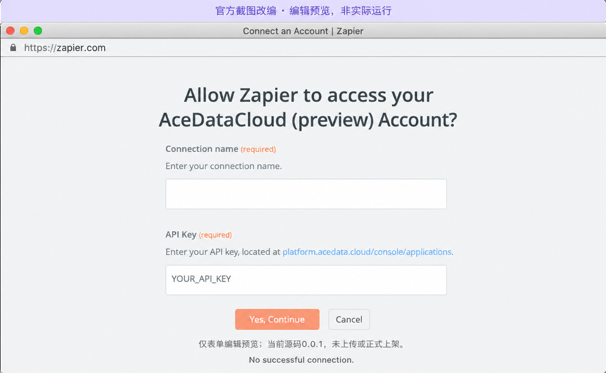

# 在 Zapier 使用 GPT Image — 由 Ace Data Cloud 提供

从当前图片 API 目录选择型号，支持 GPT Image 2.6 和已发布的 DALL·E/Nano Banana 兼容型号。发送用户选定的原始型号；图像编辑属于单独操作。 这是 Ace 提供的集成，不是 GPT Image 官方应用或背书。

[English](gpt-image.md) · [主指南](../README_zh_Hans.md)

## 1. 官方安装路径与动作

当前为源码预览0.0.1，没有已证实的私有上传、公开目录、实际安装或成功Zap。[Zapier官方目录](https://zapier.com/apps)是后续公开入口，源码不是安装。需已有管理员先上传并分享准确私有版本。公开后核关键词 `GPT Image`、`GPT Image by Ace Data Cloud` 和动作名称；不承诺索引或排名。

动作：**Generate GPT Image**；恢复：**Retrieve GPT Image Task**。同一Ace应用承载服务动作，遵循同API/auth反重复规则，不为关键词另注册空应用。

## 2. 获取正确的Token

1. 打开[Applications](https://platform.acedata.cloud/console/applications?utm_source=opensource&utm_medium=referral&utm_campaign=evergreen)，注册或登录。
2. 找到 **General application**，没有时选 **Initialize General Application**。通用Key依账号服务权限，专用应用可能限服务。
3. 复制已有Token，或 **Manage Keys → Create**，取名 `Zapier GPT Image`。复用截图中的 Dify tutorial 只是历史示例。
4. 检查过期、用量和 **Allowed APIs**，同时允许 `/openai/images/generations` 与 `/openai/tasks`。模型列表连接成功不代表拥有生成/查询权限。

只复制原始Token，不带Bearer、引号或空格；platform管理令牌不能代替。先核[当前价格](https://platform.acedata.cloud/services/openai?utm_source=opensource&utm_medium=referral&utm_campaign=evergreen)、实际余额与套餐，试用以账号显示为准；Credits不是美元，Zapier任务费用另计。

## 3. 本平台粘贴位置与参数

在连接的 **API token** 粘贴Token，**Connection name**填非敏感名字，不放在提示词和导出文件。

2026-10-17编辑、10-18复用，原拍摄日期未知；仅表单参考，不证明连接/上传/运行，也不保证当前布局。[来源](../../assets/tutorial/sources.json)。没有本服务在Zapier内真实参数/结果截图。

流程：**一次性触发 → Generate GPT Image → 用 First Completed Image URL 的后续步骤**。

| 字段 | 示例（Test会收费） |
| --- | --- |
| GPT Image Model | `gpt-image-2` |
| Image Prompt | `A plain blue ceramic mug on a cream table.` |
| Image Count | `1` |
| Image Size | `1024x1024` |
| Quality | `low` |

型号和 Quality 从当前公开 API 参数读取。张数可选 1–10，DALL·E 3 必须为 1；成功结果按所选型号计费。GPT Image 2/2.5/2.6 支持 auto 或文档范围内的 WIDTHxHEIGHT，DALL·E 使用其固定尺寸。DALL·E 2 选 standard，DALL·E 3 选 standard/hd，GPT Image 2.5/2.6 还支持 xhigh/max。回调始终关联原图片任务 ID，兼容型号也可查询原任务。

## 4. 同ID等终态与结果

Test和enabled Zap每次都会新发收费生成，先明确当日额度。动作只提交一次，带Zapier回调；回调只唤醒原ID，随后用用户凭据认证查询 `/openai/tasks`，不信任回调带来的成品链接。只有终态成功和有效HTTPS媒体才继续。

回调迟到、pending或失败时不要重放生成。用 **Retrieve GPT Image Task** 映射/粘贴原 **Ace Task ID**，继续查相同ID；查询不新生成。pending/false无成品URL，failed/false需核账，succeeded/true才映射 **First Completed Image URL**、**Completed Media URLs** 和item URL。多结果保留所有成功项。

生成429作为普通错误交人工核查，不请求Zapier自动限流重放收费动作；原任务查询429可以延后重试查询。用户设置的Autoreplay/手动重放仍可能重复生成，先查[使用记录](https://platform.acedata.cloud/console?utm_source=opensource&utm_medium=referral&utm_campaign=evergreen)，端点无跨请求幂等键。定时测试只验收一次后停用。

## 常见问题

应用不存在先查真实上传/账号权限；Token失败核完整值/过期后重连；权限需两条API；已知非法模型/时长/分辨率组合在提交前报错。内容拦截保留原义不切模型。无成品先查原ID，不重发收费请求。步骤成功也不能代替同ID终态账单。支持仅提供task/trace、模型和时间，不发Key、callback或私人prompt。[支持](https://docs.acedata.cloud/en/resources/support) · [隐私](https://docs.acedata.cloud/en/resources/privacy) · [条款](https://docs.acedata.cloud/en/resources/terms)。
