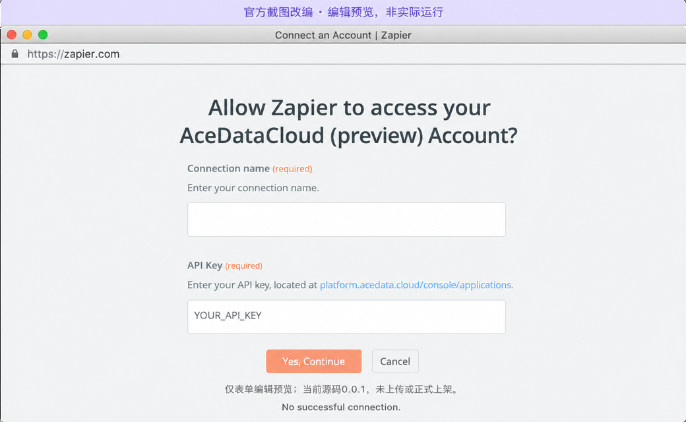

# Seedance for Zapier — by Ace Data Cloud

Text-to-video and an optional first-frame image. 1.0 Lite i2v requires that image; 1.0 Lite t2v is text-only. Audio/video references, last-frame combinations, editing and extension are outside this action. This is the Ace-provided integration, not an official Seedance app or endorsement.

[简体中文](seedance.zh-CN.md) · [Main guide](../../README.md)

## 1. Install the actual Ace app

**Source preview 0.0.1; no uploaded private version, public listing or successful Zap is evidenced.** The eventual official installation channel is [Zapier App Directory](https://zapier.com/apps). An authorized administrator must first upload and share the exact private Ace version. Do not interpret this source link as installation. After publication, search `Seedance`, `Seedance by Ace Data Cloud`, and the exact action; actual discovery and ranking must be checked.

Select **Ace Data Cloud → Generate Seedance Video**. Recover existing work with **Retrieve Seedance Video Task**. The shared application follows Zapier's one-API/auth publication rules; no duplicate app is registered just for keywords.

## 2. Register / sign in and create a scoped token

1. Open [Ace Data Cloud Applications](https://platform.acedata.cloud/console/applications?utm_source=opensource&utm_medium=referral&utm_campaign=evergreen&utm_content=seedance_zapier_guide_api_key); register or sign in.
2. Find **General application**; if absent choose **Initialize General Application**. A general key uses your entitled services, while a dedicated application may be service-limited.
3. Copy an existing API token or choose **Manage Keys → Create**. Name it `Zapier Seedance`; the reused screenshot's `Dify tutorial` is only a historical example.
4. Review expiration, usage limit and **Allowed APIs**. Include both `/seedance/videos` and `/seedance/tasks`. A successful read-only model-list connection test does not prove those generation permissions.

Copy only the raw token, without `Bearer `, quotes or spaces. A `platform-...` management token is different. Review [current service pricing](https://platform.acedata.cloud/services/seedance?utm_source=opensource&utm_medium=referral&utm_campaign=evergreen&utm_content=seedance_zapier_guide_pricing) and actual account balance/package before use. Any trial allocation is whatever your account now shows. Credits are not USD; use current package price/amount. Zapier task fees are separate.

## 3. Connect and configure the native fields

Paste the token into **API token** and put a non-secret label in **Connection name**. Do not put secrets in prompts or exports.

Official historical screenshot edited on **2026-10-17**, reused **2026-10-18**. Original capture date unknown. It is only a form preview, not a real connection/run/upload or exact current layout; [source record](../../assets/tutorial/sources.json). No real Seedance-in-Zapier parameter/result screenshot is available yet.

Build **one-off trigger → Generate Seedance Video → destination using Completed Video URL**.

| Field | Example (paid when tested) |
| --- | --- |
| Seedance Model | `doubao-seedance-2-0-fast-260128` |
| Video Prompt | `A small boat crosses a calm lake at sunrise.` |
| Duration (Seconds) | `5` |
| Resolution | `720p` |
| Aspect Ratio | `16:9` |

Select the exact model. 1.0 uses 2–12 seconds; 1.5 Pro 4–12; 2.0 4–15; 2.5 4–30. Only 1.5/2.x accept -1 for automatic duration. 2.0 Fast/Mini support 480p/720p; 2.0 Standard supports up to 4k; 2.5 up to 1080p. First-frame images must be public HTTPS URLs. Generate Audio may be set for 1.5/2.x, never 1.0.

## 4. Wait for the original task and map the result

The editor **Test** and each enabled Zap run create a paid generation. Decide a current spend budget before either. The action submits one async request with a Zapier callback. Zapier waits; callback task ID must match, and the action then uses the stored user credential to retrieve the exact same task from `/seedance/tasks`. Callback media is not trusted. Only terminal success with valid HTTPS results is passed downstream.

If a callback is late, pending or failed, do not replay generation. Use **Retrieve Seedance Video Task**, map/paste the original **Ace Task ID**, and check that same ID later. Query is not a new media generation. `pending/false` has no final URLs, `failed/false` needs review, and `succeeded/true` provides **Completed Video URL**, **Completed Media URLs** and item URL fields. Keep all successful output URLs, not only the first.

Generation rate limits raise a normal error for manual review rather than asking Zapier to throttle-replay the paid action. Existing task-query rate limits may schedule a query retry. User-enabled platform Autoreplay/manual replay can still resubmit generation: inspect [usage](https://platform.acedata.cloud/console?utm_source=opensource&utm_medium=referral&utm_campaign=evergreen&utm_content=seedance_zapier_guide_usage) first. There is no cross-request generation idempotency key. Turn off a scheduled test Zap after its one-event acceptance.

## 5. Troubleshooting

Missing app means account publication/access is not complete. Invalid token needs reconnection after checking value/expiry. Permission failure needs both APIs above. A bad duration/resolution/model combination fails before submission when locally known. Content moderation remains a blocked request; no substitution is used. Pending or missing media requires same-ID retrieval, not a new paid attempt. A green Zap step is not an independent terminal billing record.

For support, share original task/trace IDs, model and approximate time; never the token, callback URL or private prompt. [Support](https://docs.acedata.cloud/en/resources/support) · [Privacy](https://docs.acedata.cloud/en/resources/privacy) · [Terms](https://docs.acedata.cloud/en/resources/terms).
